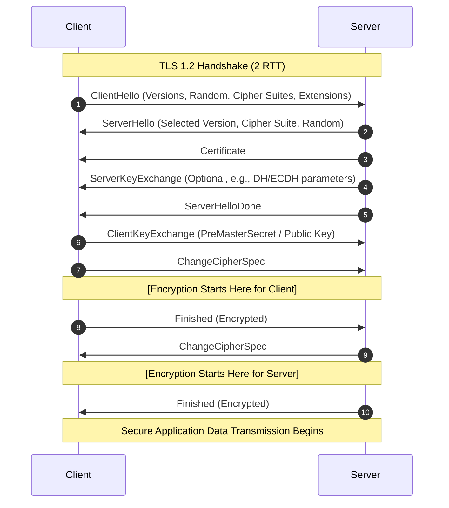
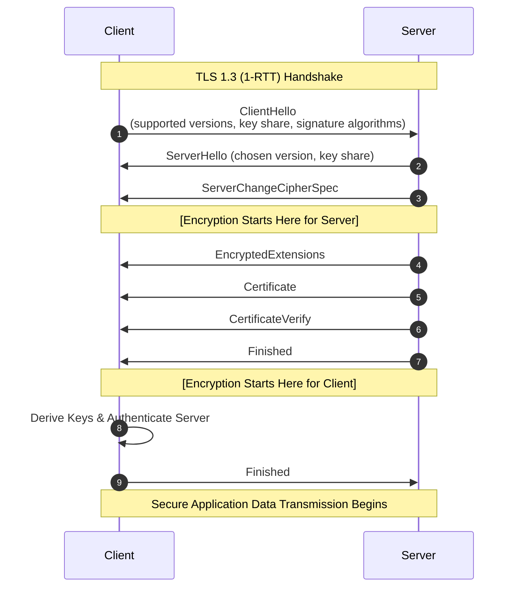
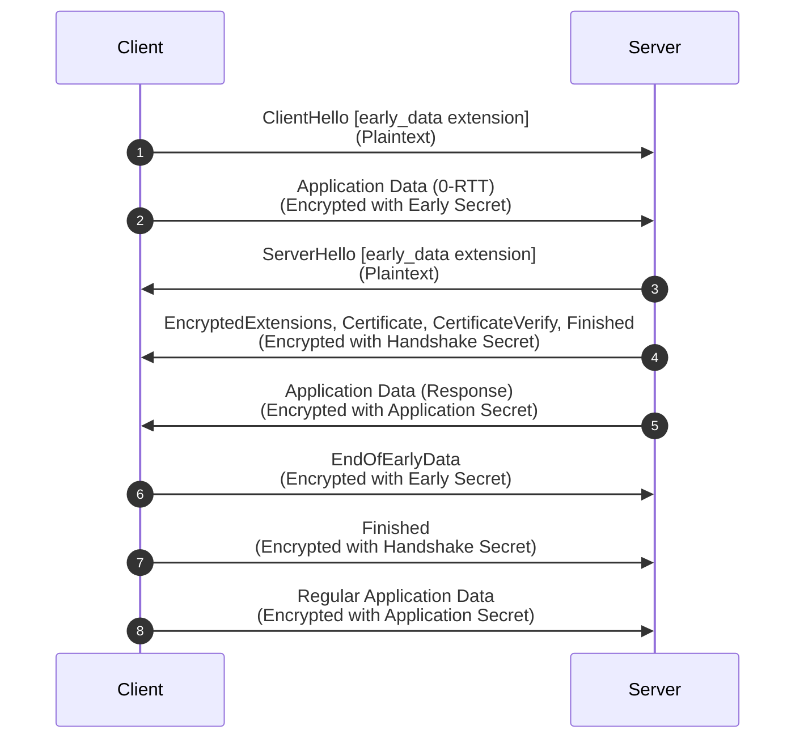
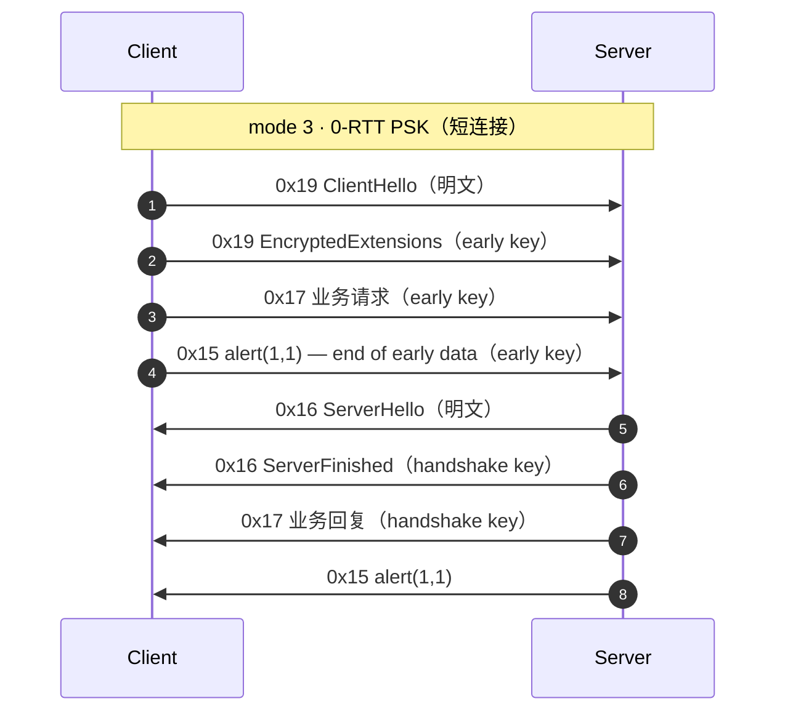

import MmtlsDump from '@site/src/components/MmtlsDump'
import {demoZeroRtt} from '@site/src/components/MmtlsDump/demo'

## 前言

我两年前就看到了 Duo 的这篇 [Telegram, QQ and Wechat](https://duo.github.io/posts/octopus-qq-wechat/) , 当时跑了一个在自己的小主机上，用起来很舒服。不用担心多设备登录的时候消息记录要来回同步，也不用担心文件过期了没来得及下载。但是这种用法现在已经是苟延残喘了，新号或者64位系统上无法登录这么老的微信。于是最近用了 Pi Agent 配合 Deepseek V4.1 Flash 探索了一下微信的 MMTLS 协议。

<!-- truncate -->

总的来说，这次尝试彻底刷新了我对二进制逆向和 AI 的印象。我一年多前就有所耳闻 Agent 搭配 MCP 后的惊人表现: [ghidraMCP: Now AI Can Reverse Malware](https://www.youtube.com/watch?v=u2vQapLAW88&t=720s). 不过这还是我第一次 hands on 去真正逆向一个复杂的大型软件。可以说在 AI 时代，只要你经历了严谨的大学计算机科班训练（这里说的严谨是 csdiy.wiki 上的课程的那种严谨），你就可以和 AI 一起在计算机世界里**学习和探索任何东西的原理**。其实我也不确定这里的前提条件到底有多重要，也许再过几年这个前提条件都可以舍去，但是你还是要向 AI 描述你要学什么，不是吗？而形成这个描述或多或少需要你和 AI 都有一些计算机基础知识。这样看来，掌握基础知识反而更重要了，相对的一些偏门的，和其他知识交集少的叶子知识完全可以等到用的时候现学。

我选择的平台是 x86_64 Linux, 一开始选这个完全是因为我主力系统就是 Archlinux, 等到后面我尝试把我实现的一些东西迁移到 Windows 或 macOS 的时候才深切地体会到 Linux 开源的内核、不那么 baby-sitting 用户的设计和不那么安全的特性使得很多事情都变得简单了很多很多，同时 Agent 也最适应 Linux 上的 Shell 环境。所以建议有 Linux 选 Linux.

参考：

- [基于TLS1.3的微信安全通信协议mmtls介绍 - GitHub](https://github.com/WeMobileDev/article/blob/master/%E5%9F%BA%E4%BA%8ETLS1.3%E7%9A%84%E5%BE%AE%E4%BF%A1%E5%AE%89%E5%85%A8%E9%80%9A%E4%BF%A1%E5%8D%8F%E8%AE%AEmmtls%E4%BB%8B%E7%BB%8D.md) ([腾讯云开发者社区](https://cloud.tencent.com/developer/article/1030950))
- [Should We Chat, Too? Security Analysis of WeChat’s MMTLS Encryption Protocol](https://citizenlab.ca/research/should-we-chat-too-security-analysis-of-wechats-mmtls-encryption-protocol/)

两篇都是在 Google 上搜索 "mmtls" 后第一页就能找到的结果。

微信采用了一种自制的传输层(TCP) - 应用层(MMPack)之间的加密协议 MMTLS。它基于 TLS 1.3 草案 (2016) 改进而来，而主流的网站一般会选择 TLS 1.3 (2018). 那么要搞清楚 MMTLS, 首先要学习一下 TLS.

## TLS

参考：

- [The Illustrated TLS 1.3 Connection](https://tls13.xargs.org/)
- [TLS Handshake - OSDev Wiki](https://wiki.osdev.org/TLS_Handshake)

TLS 及其使用的密码学是一项伟大的发明。今天每个人在使用互联网的时候都能享受到安全、私密的连接，加密技术和军事机构、金融设施等使用的并无二致，这都归功于 TLS.

TLS 的最小传输单位是 record，头结构为：

```c
struct TLSRecord {
    uint8_t  content_type;            // 1 Byte
    uint16_t legacy_record_version;   // 2 Bytes (Big-Endian)
    uint16_t length;                  // 2 Bytes (Big-Endian)
    opaque payload[TLSRecord.length];
};
```

Type 有以下几种类型：

- 0x14 (20): ChangeCipherSpec
- 0x15 (21): Alert
- 0x16 (22): Handshake
- 0x17 (23): Application Data

<svg viewBox="0 0 540 240" width="70%" height="auto" xmlns="http://www.w3.org/2000/svg" style={{fontFamily: "-apple-system, BlinkMacSystemFont, 'Segoe UI', Roboto, Helvetica, Arial, sans-serif"}}>
  <!-- 外层背景容器 -->
  <rect x="5" y="5" width="530" height="230" rx="12" style={{fill: 'var(--ifm-background-surface-color)', stroke: 'var(--ifm-color-emphasis-300)'}} strokeWidth="3" />
  <!-- 上层：Handshake -->
  <rect x="25" y="30" width="145" height="65" rx="8" style={{fill: 'var(--ifm-color-emphasis-100)', stroke: 'var(--ifm-color-primary)'}} strokeWidth="2.5" />
  <text x="97" y="69" fontSize="18" textAnchor="middle" fontWeight="600" style={{fill: 'var(--ifm-font-color-base)'}}>Handshake</text>
  <!-- 上层：Alert -->
  <rect x="195" y="30" width="145" height="65" rx="8" style={{fill: 'var(--ifm-color-emphasis-100)', stroke: 'var(--ifm-color-primary)'}} strokeWidth="2.5" />
  <text x="267" y="69" fontSize="18" textAnchor="middle" fontWeight="600" style={{fill: 'var(--ifm-font-color-base)'}}>Alert</text>
  <!-- 上层：Application Protocol -->
  <rect x="365" y="30" width="145" height="65" rx="8" style={{fill: 'var(--ifm-color-emphasis-100)', stroke: 'var(--ifm-color-primary-light)'}} strokeWidth="2.5" />
  <text x="437" y="58" fontSize="16" textAnchor="middle" fontWeight="600" style={{fill: 'var(--ifm-font-color-base)'}}>Application</text>
  <text x="437" y="79" fontSize="16" textAnchor="middle" fontWeight="600" style={{fill: 'var(--ifm-font-color-base)'}}>Protocol</text>
  <!-- 下层：Record -->
  <rect x="25" y="125" width="485" height="85" rx="8" style={{fill: 'var(--ifm-color-emphasis-200)', stroke: 'var(--ifm-color-primary-dark)'}} strokeWidth="3" />
  <text x="267" y="175" fontSize="22" textAnchor="middle" fontWeight="600" style={{fill: 'var(--ifm-font-color-base)'}}>Record</text>
</svg>

如图，Handshake 是 Record 的子协议。我们主要看 Handshake. Handshake 的内部结构：

```c
struct HandshakePayload {
    uint8_t msg_type;              /* 1 byte */
    uint24 length;                 /* 3 bytes */
    opaque body[Handshake.length];
};
```

Handshake 的 type 可以参考下图，包括 ClientHello、ServerHello、Certificate 等等。

在大多数情况下，握手过程中双方交换下列信息：

- 对要使用什么 cipher suites (ciphers and hash functions) 达成共识。
- server 对 client 提供自己的证书（里面包含 server 的公钥），供 client 验证自己的身份。
- 本次 TLS 会话的 session keys. 这是后续传输 Application Data 时真正使用的对称加密密钥。

交换后面这两条信息还需要用到非对称加密。

### 一些前置知识

#### RSA 非对称密码

参考：https://brilliant.org/wiki/rsa-encryption/

RSA 的基本原理是：把两个超大的素数乘起来很容易，但是把乘起来的这个数分解回两个素数很难。这个两个超大素数 $p,q$ 的乘积 $n$ 就是公钥的一部分。

1. 选定两个大素数 $p,q$, 计算乘积 $n=pq$
2. 计算 $\phi(pq)=(p-1)(q-1)$ 其中 $\phi$ 是 [Euler's totient function](https://en.wikipedia.org/wiki/Euler%27s_totient_function). 然后选定一个和 $\phi(pq)$ 互质的数 $e$. 公钥即为 $\{e, n\}$
3. 计算 $e$ 在模 $\phi(n)$ 下的 modular inverse，作为私钥 $d$. 也就是 $de \equiv 1 \pmod{\phi(n)}$. 如果上一步选择的 $e$ 不与 $\phi(n)$ 互质，那它就没有模 $\phi(n)$ 下的 inverse, 因此必须互质。
4. 分发公钥 $\{e,n\}$, 私钥 $d$ 保密，只留给自己

密钥制作完成，要加解密就是把信息 $m$ 做快速幂。

加密：
$$
c \equiv m ^ e \pmod n
$$
得到 ciphertext $c$

解密：
$$
c ^ d \equiv m \pmod n
$$
如果 $m$ 比 $n$ 还大，那就只能得到 $m \bmod n$ 了。由此可见 RSA 只适合加密不太长的密文，而且公钥比较长。这就是为什么 TLS 需要用非对称加密协商出对称加密的密钥(master secret)然后只使用对称加密。

正确性证明见附录 A, 其实很短（

RSA 的问题在于公钥很长，所以后面又发展了基于椭圆曲线的非对称加密算法如 Ed25519，但是对外抽象出的接口和 RSA 一样，也是公钥私钥。

#### Diffie–Hellman 密钥交换

原版 DH 很简单：

1. 双方确定一个大素数 $p$ (名字源于prime) 和一个随机数 $g$ (名字源于generator)，可以明文公开，固定不变
2. 客户端随机选一个数 $a$ （私钥）不告诉任何人，只明文发给服务器 $A=g^a \bmod p$（公钥）
3. 服务器随机选一个数 $b$ （私钥）不告诉任何人，只明文发给客户端 $B=g^b \bmod p$（公钥）
4. 两边同时把收到的数和自己随机选的数做快速幂，都能得到 $g^{ab} \bmod p$, 这就是交换出的共有密钥。

DH (Diffie-Hellman) 和 DHE (Diffie-Hellman Ephemeral) 的区别就是每次连接用不同的 $a$ 和 $b$（Ephemeral）, $g$ 和 $p$ 一般是固定的。

DH 的私钥是**绝对不会在网络上传输的**。

DH 也有椭圆曲线的版本，为 ECDH 和 ECDHE, 大部分网站使用 ECDHE.

密钥交换表面上看起来已经足够了，但是实际上攻击者可能会充当中间人，为了验证服务器的身份，还是需要 RSA 或者 Ed25519.

#### 椭圆曲线

参考：[A (Relatively Easy To Understand) Primer on Elliptic Curve Cryptography](https://blog.cloudflare.com/a-relatively-easy-to-understand-primer-on-elliptic-curve-cryptography/)

ECDH 密钥交换：

1. 双方确定一个 y² = x³ + ax + b Weierstrass 椭圆曲线的 `a`，`b` 和 `max` (坐标系在哪里 warp around), 还有生成点 $G$ (二维坐标).
2. 客户端随机选一个标量 $b$ 不告诉任何人，只明文发给服务器 $P_a = G \cdot a$
3. 服务器随机选一个标量 $a$ 不告诉任何人，只明文发给客户端 $P_b = G \cdot b$
4. 跟 DH 思路一样，把收到的点和自己的随机标量乘起来，两边都能得到 $K=G \cdot a \cdot b$

注意这里的标量和椭圆曲线上的点做乘积是一个专门定义的操作，不是向量和标量的乘积。

同样这里的标量私钥也绝不会在网络上传输。

上述为经典标准 ECDH 密钥交换，现代密码学工业标准如 X25519 明确指定了 1 中使用的曲线（没有用 Weierstrass 椭圆曲线而是改用了一个指定的 Montgomery 曲线），以及做了一些防呆设计。

### TLS 1.2



1. 客户端发送 ClientHello，告诉服务器：这是我的 ClientRandom 随机数，这是我支持的加密套件，这是我的扩展
2. 服务器发送 ServerHello：这是我选中的加密套件，这是我的 ServerRandom 随机数
3. 服务器提供自己的证书，包含证书公钥。若使用 RSA 密钥交换，客户端会用这个 RSA 公钥加密 Pre-master Secret.
4. 若使用 DH 密钥交换，服务器发送密钥交换参数，包含本次握手生成的 DH 公钥。为了防止中间人篡改或伪造这些参数，服务器会用自己证书中的私钥，对一段特定数据（包含：Client Hello 随机数 + Server Hello 随机数 + 服务器的 DH 参数）进行数字签名，附在后面一起发送。
5. 服务器：我已经发完本次连接的握手信息了。
6. 客户端向服务器交换密钥。若使用 RSA 密钥交换，客户端会直接本地生成 Pre-master Secret 然后用证书 RSA 公钥加密后发给服务器。若使用 DH 密钥交换，客户端会把本次握手的 DH 公钥发给服务器，并把客户端 DH 私钥和 4 中收到的服务器 DH 公钥相乘得到 Pre-master Secret. 然后使用下面的算法生成 Master Secret. 服务器也可以用同样的算法生成同样的 Master Secret.

```
seed = "master secret" + client_random + server_random
a0 = seed
a1 = HMAC-SHA256(key=PreMasterSecret, data=a0)
a2 = HMAC-SHA256(key=PreMasterSecret, data=a1)
p1 = HMAC-SHA256(key=PreMasterSecret, data=a1 + seed)
p2 = HMAC-SHA256(key=PreMasterSecret, data=a2 + seed)
MasterSecret = p1[all 32 bytes] + p2[first 16 bytes]
```

得到 Master Secret 后可以派生出后续使用的 session keys

```
seed = "key expansion" + server_random + client_random
a0 = seed
a1 = HMAC-SHA256(key=MasterSecret, data=a0)
a2 = HMAC-SHA256(key=MasterSecret, data=a1)
a3 = HMAC-SHA256(key=MasterSecret, data=a2)
a4 = ...
p1 = HMAC-SHA256(key=MasterSecret, data=a1 + seed)
p2 = HMAC-SHA256(key=MasterSecret, data=a2 + seed)
p3 = HMAC-SHA256(key=MasterSecret, data=a3 + seed)
p4 = ...
p = p1 + p2 + p3 + p4 ...
client write mac key = [first 20 bytes of p]
server write mac key = [next 20 bytes of p]
client write key = [next 16 bytes of p]
server write key = [next 16 bytes of p]
client write IV = [next 16 bytes of p]
server write IV = [next 16 bytes of p]
```

7. 客户端：我切换到加密连接了，后续 record 都是 session keys 加密的。
8. 客户端：我已经发完本次连接的握手信息了。为了防止中间人攻击，发送 verify data: `hash(所有握手信息)` 。注意这个 record 经过密钥加密。
9. 服务器得到 Pre-master Secret, 用同样的方式派生出同样的密钥，然后告诉客户端：我已经切换到加密连接了，后续 record 都是加密的。
10. 服务器：完成 Handshake 了，我也发送 verify data: `hash(所有握手信息)` 供客户端验证。同样这个 record 经过加密。
11. 双方开始正式传输 Application Data

### TLS 1.3 (1-RTT)

上面 TLS 1.2 的握手过程是 2-RTT 的，仔细观察会发现第一个 RTT 是在协商用什么加密套件，因为必须得确定好用什么加密套件，才能交换密钥。如果客户端提前猜一个服务器支持的加密套件，然后在 ClientHello 的时候就顺便发送 ClientKeyExchange, 服务器看到了就直接回 ServerHello 和 ServerKeyExchange 那么就可以省下一个 RTT. 这就是 TLS 1.3 1-RTT 完整握手模式.

此外 TLS 1.3 抛弃了 RSA 密钥交换方式，只剩 (EC)DHE 密钥交换方式。



1. 客户端发送 ClientHello, 为了兼容性所以保留了 TLS 1.2 的格式，使用**扩展**发送 TLS 1.3 新加的字段：支持的 TLS 版本、密钥交换信息、客户端支持的签名算法
2. 服务器发送 ServerHello, 扩展包含服务器支持的版本（自然就是 TLS 1.3 了）、密钥交换信息
3. 服务器派生出 session keys, 告诉客户端：我接下来要加密传输信息了
4. 为了兼容性所以会假装为成功 resume 的 TLS 1.2 session, 实际上传输 EncryptedExtensions，包含不需要明文暴露的**扩展**
5. 服务器证书
6. 服务器用证书私钥给密钥交换时的信息签名，以证明自己的身份
7. 服务器告诉客户端握手阶段结束。和 TLS 1.2 一样，会附上 verify data
8. 客户端派生密钥并验证服务器身份
9. 客户端告诉服务器握手阶段结束。和 TLS 1.2 一样，会附上 verify data

### TLS 1.3 (0-RTT)

如果双方已经提前交换好了一个 PSK (pre-shared key), 那么可以做到 0-RTT: 在 ClientHello 里带上 PSK 和 `early_data` 扩展，后面紧跟着就把 Application Data 发出去。



如何交换 PSK 呢？一种方法是在一次完整 1-RTT 握手结束后，服务器会给客户端发一个 NewSessionTicket，里面包含 ticket 和 `max_early_data_size`. 客户端下次连接就把 ticket 放进 ClientHello 的 `pre_shared_key` 扩展。这个扩展还带一个 binder, 它是对（去掉 binders 的）ClientHello 做的 HMAC, key 由 PSK 派生，所以既能证明自己确实持有 PSK, 又能防止中间人篡改 ClientHello 里的其它字段。也因此 `pre_shared_key` 必须是 ClientHello 的最后一个扩展，否则没法对着“完整的” ClientHello 算 HMAC.

0-RTT 的密钥只由 PSK 得到：

```
/* 1. 提取 Early Secret */
// 若无预共享密钥 (PSK)，则 PSK 输入为全 0 的 Hash_Len 字节串
Early_Secret = HKDF-Extract(salt = 0, IKM = PSK)

/* 2. 派生 client_early_traffic_secret */
// 基于 Early Secret 与 ClientHello 上下文派生
client_early_traffic_secret = HKDF-Expand-Label(
    secret  = Early_Secret,
    label   = "c e traffic",
    context = Transcript-Hash(ClientHello),
    length  = Hash_Len
)
```

服务器看到 `early_data` 有三种选择：

1. 忽略它、回退到 1-RTT
2. 回一个 HelloRetryRequest (之后客户端不能再发 0-RTT)
3. 接受。接受的条件是 PSK 是客户端列出的第一个 identity, 并且版本、加密套件、ALPN 都和当初发 ticket 的那次连接一致。接受的话，服务器在 EncryptedExtensions 里回一个 `early_data` 表示“我收了”。客户端收到服务器的 Finished 后，先发一个 `EndOfEarlyData` 表示 0-RTT 数据已经发完，从这里开始换回握手密钥，然后再发自己的 Finished.

0-RTT 的缺点：

- **没有前向保密。** early data 的密钥只由 PSK 派生，不含本次握手的 (EC)DHE. PSK 一旦泄露，之前的 0-RTT 数据就都能被解开。
- **可以重放。** 1-RTT 及之后的数据依赖 ServerHello 里的 random, 每次连接都不同；0-RTT 数据不依赖它，攻击者把 ClientHello + early data 原样再发一遍，服务器算出来的 key 是一样的。所以 RFC 要求客户端只把**可以安全重放**的数据放进 0-RTT (一般就是幂等的请求), 服务端则用一次性 ticket 或者记录最近收到的 ClientHello 来防重放。很多实现也就只把 GET 之类放进来。

## MMTLS

### 微信为什么不直接用 TLS 1.3

按腾讯自己的说法（参考 1），主要有两个原因：

1. 微信的流量以**短连接**为主：一次 CGI 一问一答就结束。这种场景下 TLS 1.2 的 2-RTT 不可接受，即使 TLS 1.3 的 1-RTT 也仍然意味着「先握一次手，才能发请求」，只有 0-RTT 才是真的把请求塞进第一个包里。
2. 2016 年 TLS 1.3 的 0-RTT 还在草案里，实现也不多；而微信的需求很具体（短连接、可定制的 PSK 生命周期、长连接心跳）。

所以 MMTLS 可以理解为「以 TLS 1.3 draft 为蓝本、舍弃通用性、把 0-RTT 变成一等公民」的私有协议。因为 MMTLS 不用考虑通用性和历史包袱，所以它比 TLS 1.3 更简洁。在密码学方面，MMTLS 使用的都是现成的标准算法: ECDHE、HKDF、AES-GCM 等。

### MMTLS over HTTP

短连接的 MMTLS Record 就是明文 HTTP (Port 80) 的 body：

```
POST /mmtls/6ae19939 HTTP/1.1
Accept: */*
Cache-Control: no-cache
Connection: keep-alive
Content-Length: 300
Content-Type: application/octet-stream
Host: szshort.weixin.qq.com
Upgrade: mmtls
User-Agent: MicroMessenger Client

<300 字节的 MMTLS record 流>
```

`Upgrade: mmtls` 只是给中间设备看的，服务端并不真的做 HTTP Upgrade。

URL 里的 `6ae19939` 是 `time(NULL)` 的 `%08llx`（对应 2026-10-28 06:42:01Z），它还会原样出现在 0-RTT 的 `EncryptedExtensions` 里。

长连接则是裸 TCP（常见 Port 8080），载荷前面套一层 16 字节的 mars 长连接头（总长、magic、cmdid、seq），MMTLS 记录再包在里面。

### 记录层

```c
struct MMTLSRecord {
    uint8_t  type;     // 0x15 alert / 0x16 handshake / 0x17 application data / 0x19 early data
    uint8_t  magic;    // 固定 0xF1
    uint8_t  version;  // 0x04
    uint16_t length;   // Big-Endian，密文长度（长度计算含 16 字节 GCM tag）
    opaque   payload[length];
};
```

形式上很像 TLS 1.3. 第二个字节是硬编码的 magic（用来快速识别「这是 MMTLS」），第三个字节是协议版本。

每条加密记录的 AEAD 参数：

```
nonce = iv[0:8] || ( be32(iv[8:12]) ^ seq )     // seq 从 1 开始，逐条 +1
aad   = be64(seq) || 5 字节记录头
plain = AES-128-GCM-Open(key, nonce, 密文 || tag16, aad)
```

注意 **AAD 里带了 seq**。这是 TLS 1.3 **早期草案**（draft-04 ~ draft-13）的写法：

```
additional_data = seq_num + TLSPlaintext.type + TLSPlaintext.version + TLSPlaintext.length
```

后来草案去掉了 length、再后来又去掉了 type，到 RFC 8446 就只剩 5 字节记录头了。MMTLS 正好卡在最初那一版——所以「能不能解开」同时依赖 seq 和记录头，这点在做离线解密时坑了很久。

另一个细节：握手阶段的明文记录（ClientHello / ServerHello）**不占 seq**，第一条加密记录的 seq 就是 1。

### 三种握手模式

TLS 1.3 里「用不用 PSK」「发不发 early data」是**运行时协商**出来的（扩展 + 服务端选择）。MMTLS 直接把它固化成三种模式，由**客户端本地**在建连之前就决定（详见参考 1： 3.2.3 mmtls 对认证密钥协商的选择）：

| mode | 名称 | 条件 | 密码套件 |
|---|---|---|---|
| 1 | 1-RTT ECDHE | 手上没有可用的 PSK | `0xC02B` (ECDHE_ECDSA_AES128_GCM) |
| 2 | 1-RTT PSK | 有 PSK，但建连时没有待发的业务数据（典型：长连接） | `0x00A8` (PSK_AES128_GCM) |
| 3 | 0-RTT PSK | 有 PSK，且短连接的请求体已经准备好 | `0x00A8` (PSK_AES128_GCM) |

决策就在客户端：查本地凭据库拿 PSK（内部叫 `PSK_ACCESS`），有 PSK 且带了请求体 → mode 3；有 PSK 但没带请求体 → mode 2；没 PSK → mode 1。**0-RTT 只用于短连接**：长连接建连时不会有「待发的请求体」，客户端对此有硬性限制（0-RTT 与长连接互斥）。

由于登录后的短连接都是 mode 3, 因此 mode 3 最方便观察。mode 3 的握手流程图：



几个和 TLS 1.3 不一样的点：

- 0-RTT 时 **ClientHello 本身走 `0x19` 记录**（TLS 1.3 里 ClientHello 永远是 `0x16`，只是在内部带 `early_data` 扩展）；
- **EndOfEarlyData 不是握手消息，而是一个 `alert(level=1, description=1)`**。TLS 1.3 里它是一个 handshake 消息类型，MMTLS 把这一步压成一个 warning alert；
- 明文 ServerHello 之后服务端就发 `0x16 ServerFinished`，客户端**不发 ClientFinished**（请求早就发完了），直接进入读业务回复。

mode 1 就是常规完整握手：`ClientHello → ServerHello → CertificateVerify → NewSessionTicket → ServerFinished → ClientFinished`，这一次握手拿到的 PSK 才能让下次升级到 0-RTT。注意 MMTLS **没有 Certificate 消息**——服务端身份靠预置的静态 ECDH 公钥 + `CertificateVerify` 里的 ECDSA 签名验证，没有 X.509 证书链。

### 拆一段 hex 看看

你可以打开 Wireshark 抓一个微信的 HTTP 包（大概率是 mode 3 0-RTT MMTLS 包），然后 `Copy → as a Hex Dump` 贴进下面的输入框（`as Hex Stream` / `as Escaped String` 也支持）。Frame / Ethernet / IPv4 / TCP 那几层不用管——粘整帧也行，它会自己跳到 HTTP 或 MMTLS 记录的位置开始解析。由于我们还没有密钥，所以只能看到明文握手信息和密文握手信息、应用数据。

<MmtlsDump
  initial={demoZeroRtt}
  caption="一条 mode 3 的 0-RTT 短连接（示例数据，结构与真实抓包一致）。鼠标停在任何一行字段上，都会高亮下面「原始字节」里对应的那几个字节"
/>

几点注释：

- ClientHello 里只有一个扩展 `PreSharedKey`（0x000f），**没有** ClientKeyShare——0-RTT 不做 ECDHE，这正是它没有前向保密的原因；
- `Lifetime` 是 604800 秒（7 天）；
- 第 4 条 `0x15` 的明文其实是 `len=3 | type=0 (Alert) | description=1 | level=1`，也就是 end of early data，只是它同样被 early key 加密了，所以这里只能看到 7 字节密文 + 16 字节 tag。

### 密钥派生

MMTLS 的密钥扩展只有一个原语：

```
HKDF-Expand(PRK, label ‖ H, L)
```

`H` 是 transcript：把到目前为止收发过的握手消息按线上顺序拼起来做 sha256。每条消息就是记录体里那一段（**包含开头 4 字节的长度前缀**），所以只要抓到一条链路就能离线复算——这也是后面能拿一条抓包验证 PSK 的原因。

整套只有两个「秘密槽」，外加完整握手时多出来的一个 master：

```
secret A  = PSK_ACCESS  或  sha256(ECDH 共享点的 x 坐标)
secret B  = 同一个值（PSK 模式把同一份 PSK 写进两个槽，
                       ECDH 模式把同一个共享秘密写进两个槽）
master    = 仅完整握手，由 A（或 A + B）再派生 32 字节
```

实测路径里 A 和 B 永远相等，可以直接当成一个秘密看；两个槽分开是为了「静态密钥 + 临时密钥」混用的场景，见下面 master 那一段。

#### 一共有 6 种 key

| # | 名字 | 长度 | PRK | label | H 到哪一步 |
|---|---|---|---|---|---|
| 1 | `early key` | 28 | A | `early data key expansion` | 只有 ClientHello |
| 2 | `handshake key` | 28 / 56 | B | `handshake key expansion` | mode 3：CH‖EE‖SH<br />mode 1/2：CH‖SH |
| 3 | `master secret` | 32 | A（或 A + B） | `expanded secret`（另有 static / ephemeral 两个变体） | 到 ClientFinished |
| 4 | `application data key` | 56 | master | `application data key expansion` | 到 ClientFinished |
| 5 | `PSK_ACCESS` | 32 | B | `PSK_ACCESS` | 到 CertificateVerify |
| 6 | `PSK_REFRESH` | 32 | B | `PSK_REFRESH` | 同上 |

28 = 一个方向的 `key16 + iv12`，56 = 两个方向各一套，32 = 裸秘密。#1 #2 #4 才是真正喂给 AES-128-GCM 的；#3 是中间值；#5 #6 是下一轮连接的「根」，不直接加密任何东西。Finished 的 `verify_data` 也在同一份 transcript 上算，但那是 MAC，不算加密 key。

#### mode 3（0-RTT PSK）

```python
# ---- 客户端发首飞 ----
H1 = sha256(ClientHello)
early = HKDF-Expand(PSK_ACCESS, "early data key expansion" ‖ H1, 28)   # 只有 c2s

# 用 early 加密：EncryptedExtensions → 业务请求(0x17) → alert(1,1)
# ClientHello 本身是明文，它也是 transcript 的一部分

# ---- 收到明文 ServerHello 之后 ----
H2 = sha256(ClientHello ‖ EE 明文 ‖ ServerHello)
hs = HKDF-Expand(PSK_ACCESS, "handshake key expansion" ‖ H2, 28)       # 只有 s2c

# 服务端后续的 0x16 / 0x17 / 0x15 全部用 hs 解 —— 没有 app key
```

这里**没有** #3 #4：连接在 ServerFinished / 业务回包之后就结束了，不需要再切一次钥。`hs` 的 28 字节会被同时填进收、发两个方向的状态里，所以实现时不用纠结「哪一半是谁的」。

#### mode 2（1-RTT PSK）

```python
H1 = sha256(ClientHello ‖ ServerHello)
hs = HKDF-Expand(PSK_ACCESS, "handshake key expansion" ‖ H1, 56)       # 双向
# 之后所有 0x16 / 0x17 用 hs
```

和 mode 3 的区别就是 **28 变 56**：这次没有 early data，transcript 里没有「客户端已经发出去的半截数据」，握手可以一次算齐两个方向。

#### mode 1（完整 ECDHE）

```python
x      = ECDH(客户端私钥, 服务端公钥)      # OpenSSL ECDH_compute_key，x 坐标 32B
secret = sha256(x)                        # 同时写进 A、B 两个槽

H_hs = sha256(ClientHello ‖ ServerHello)
hs   = HKDF-Expand(secret, "handshake key expansion" ‖ H_hs, 56)      # 双向

# → CertificateVerify → NewSessionTicket → ServerFinished
H_psk = sha256(CH ‖ SH ‖ CV)              # 解析 NST 时算，NST 自己还没进 transcript
PSK_ACCESS  = HKDF-Expand(secret, "PSK_ACCESS"  ‖ H_psk, 32)
PSK_REFRESH = HKDF-Expand(secret, "PSK_REFRESH" ‖ H_psk, 32)

# → ClientFinished（这条记录仍然用 hs 加密，app 是它之后才装上的）
H_m    = sha256(CH ‖ SH ‖ CV ‖ NST ‖ SF ‖ CF)
master = HKDF-Expand(secret, "expanded secret" ‖ H_m, 32)
app    = HKDF-Expand(master, "application data key expansion" ‖ H_m, 56)
```

注意 master / app 的 transcript 里**包含刚发出去的 ClientFinished**：先把它写进发送缓冲（顺便并入 transcript），然后才算 master、装 app key。

#### master secret 的三个 label

正常路径（A == B）只做一次 Expand，输出 32 字节存到 channel 的 master 槽：

```python
master = HKDF-Expand(A, "expanded secret" ‖ H_m, 32)
```

如果两个槽不相等（客户端用「静态密钥 + 临时密钥」两条密钥材料时），才会走另一条路：先各自 Expand，再 Extract 起来：

```python
st = HKDF-Expand(A, "expanded static secret"    ‖ H_m, 32)
ep = HKDF-Expand(B, "expanded ephemeral secret" ‖ H_m, 32)
master = HKDF-Extract(st, ep)          # 32 字节
```

这三条路在二进制里都还在，但我抓的客户端流量里 A 一直等于 B，所以只有 `expanded secret` 会被用到；写客户端时按第一条实现就能对上。

#### PSK 是怎么传下去的

一次完整握手结束时，服务端会发 `NewSessionTicket`，客户端从里面解出下一轮的凭据（注意用的是 secret B，不是 master）：

```python
PSK_ACCESS  = HKDF-Expand(B, "PSK_ACCESS"  ‖ H, 32)     # 下一次 0-RTT / 1-RTT 的 PRK
PSK_REFRESH = HKDF-Expand(B, "PSK_REFRESH" ‖ H, 32)     # 备用
```

票本身长这样（就是 ClientHello 里 `PreSharedKey` 扩展带的那坨）：

```
Psk = type:u8 | lifetime:u32 | mac_len:u16 | mac | key_version:u32
    | nonce_len:u16 | nonce | ticket_len:u16 | ticket
```

`type = 1` 是 ACCESS（0-RTT 用），`type = 2` 是 REFRESH。本机磁盘上的 `psk.key.` 里存的是 REFRESH，ACCESS 基本只活在进程内存里；两者都是「登录级」的，实测 `lifetime = 604800` 秒（7 天）。

#### PSK 的一生

把上面几步串起来，一份 PSK 的完整生命周期是这样一个循环：

```
没有 PSK ──(mode 1 完整握手 + NewSessionTicket)──▶ 有 PSK（ACCESS / REFRESH）
    ▲                                                      │
    │                                                      │ mode 2 / 3 直接拿它算 key
    │                                                      ▼
    └─────────── alert 115（服务端说这份 PSK 不能用了）───────┘
```

两个要点：**新 PSK 只能由完整握手产生**（`NewSessionTicket` 是唯一来源），而**作废是服务端单方面决定的**——客户端没有任何「续期」或「协商」的余地，只能被动跟随。

**alert 115 长什么样**。它是明文的，不需要密钥就能在抓包里认出来，这是排查时最有用的一条信号：

```
15 f1 04 00 07  00 00 00 03 00 73 02
│  │  │  └─ len=7
│  │  └──── 记录版本（0x04 = 短连接）
│  └─────── magic 0xF1
└────────── 记录类型 0x15 = alert
                └─────────────── 0x73 = 115（fatal）
```

客户端收到它的动作是两步：这条连接按服务端给的 fallback 信息改走别的路径，同时把手上的 ACCESS PSK **丢掉**。于是下一次建连时本地没有 PSK 了，自然退回 mode 1 完整握手，再通过 `NewSessionTicket` 拿一份新的。

**实测的轮换节奏**。一条短连接只对应一次 115（不是一条连接反复重试），所以「PSK 失效」在抓包里的形状是一串连接，每条都收到 115：

| 相对时间 | 发生了什么 |
|---|---|
| T+0 | 客户端拿旧 PSK 发 0-RTT 请求 |
| T+0 | 服务端不回业务数据，只回 `0x15 alert(115)` |
| T+1s / 3s / 7s / 15s / 31s / 61s / 91s | 新连接重试，仍然 115（退避 1→2→4→8→16→30→30 秒） |
| T+1.5 ～ 5 分钟 | 放弃 0-RTT，退到 mode 1 完整握手，拿到新 PSK |
| 之后 | 短连接又是 mode 3，恢复正常 |

一轮下来 1.5～5 分钟，和退避上限（30 秒）以及「重握手 + 换新 PSK」的耗时对得上。

**7 天是上限，不是寿命**。`lifetime = 604800` 只是这张票声明的最长有效期，实际寿命取决于服务端什么时候轮换——实测短得多（小时级）。另外要区分两件事：**PSK 失效 ≠ 账号失效**。前者只会让连接退化成 mode 1，抓包里表现为一串 115 + 一次完整握手；后者是另一回事（业务接口开始返回错误码）。

**怎么在抓包里认出来**：

- `ClientHello` 里有没有 `PreSharedKey`（0x000f）扩展 —— 有就是 PSK 模式，且这扩展是明文的；
- 0-RTT 首飞里**没有** `ClientKeyShare`，这是「只靠 PSK、不做 ECDHE」的直接证据；
- 看到明文的 `0x15 alert(115)`，说明这条链路上的 PSK 已经不好用了；
- 一次完整握手之后必定跟一个 `NewSessionTicket`——它是新 PSK 的唯一来源。

#### 注意事项

1. **28 vs 56 是「算得出来几个方向」，不是「哪种模式更安全」**。0-RTT 的首飞只能算 c2s（服务端还没说话，transcript 里没有它的 random），所以只能展开一个方向；`handshake key expansion` 在 0-RTT 里也只展开 s2c。
2. **0-RTT 没有 `application data key`。** 服务端回的 `0x17` 用的是那把 28 字节 handshake key，所以「一把 PSK 解开整条 0-RTT 连接」是设计如此，不是实现偷懒。
3. **`iv` 不是随机数，是派生出来的一半**，12 字节；每条记录真正用的 nonce 还要 `iv[0:8] ‖ (be32(iv[8:12]) ^ seq)`，`seq` 从 1 开始逐条加。

### 和 TLS 1.3 的差异

| | TLS 1.3 (RFC 8446) | MMTLS |
|---|---|---|
| 承载 | TCP 上的 record 流 | 短连接：明文 HTTP POST body；长连接：裸 TCP + 16B 长连头 |
| 记录头 | type + legacy_version + length | type + magic(0xF1) + version + length |
| 版本协商 | `supported_versions` 扩展 | 没有；记录头一个字节 + 密码套件 |
| 身份验证 | X.509 证书链 + CertificateVerify | 预置静态 ECDH/ECDSA 公钥 + CertificateVerify（无证书消息） |
| 密钥交换 | (EC)DHE，每次连接一把 | mode 1 同；mode 2/3 直接用 PSK，不做 ECDHE |
| 0-RTT 触发 | `early_data` 扩展 + PSK | 客户端本地决定（mode 3） |
| EndOfEarlyData | Handshake 消息 | `alert(1,1)` |
| 拒绝 0-RTT | 不回 early_data，退回 1-RTT | 明文 `0x15 alert(115)`：让这条连接回退、并作废客户端手上的 PSK；`116` 则携带一份 region / host 级配置 |
| 密钥派生 | HKDF-Extract + Expand-Label（`c hs traffic`…） | 只 Expand，`label \|\| transcript_hash` |
| AEAD AAD | 5 字节记录头 | **seq(8B) + 5 字节记录头**（草案写法） |
| 心跳 | 无（靠应用层） | 有独立的 Heartbeat 消息 |
| 实现 | 一套 | 两套并存：手写实现 + 后来基于 OpenSSL 的 mmtls2（按 host 开关） |

最后一行说的是 MMTLS 有两套并行实现：一套手写（自己调度 record / HKDF / AEAD），另一套叫 mmtls2，基于现成的 TLS 库实现，靠 session ticket 缓存做 0-RTT。服务端会通过配置下发「哪些 host 用 mmtls2」，所以不同账号/地区看到的实现可能不一样，但线上记录格式是一致的。

### 安全性

1. **0-RTT 没有前向保密**，和 TLS 1.3 一样：early key 只由 PSK 派生，不含本次握手的 (EC)DHE。PSK 泄露 = 之前所有 0-RTT 数据可解。
2. **0-RTT 可以重放**：c2s 的 early key 只依赖 `sha256(ClientHello)`，不含 ServerHello 的 random，所以攻击者拿到 `ClientHello + early data` 可以原样重发，服务端算出来的 key 一模一样。TLS 1.3 用「一次性 ticket + 只允许幂等请求」缓解，MMTLS 是否有等价防护我没法从客户端侧确认。
3. **PSK 的生命周期很长**：`PSK_ACCESS` 是**登录级**的（小时~天级），不像 TLS 1.3 的 ticket 那么短。加上 mode 2/3 完全不做 ECDHE，意味着这段时间里整条连接的机密性都挂在同一个 32 字节秘密上。
4. **PSK 是可验证的**。这点挺有意思：一般会觉得「密钥不能离线验证」，但 MMTLS 的 AEAD 里 AAD 含 seq 和记录头，所以拿一条抓包 + 一个候选 PSK 就能判真（GCM tag），甚至不需要知道明文。实现客户端时这一点很好用：手里任何一份 32 字节候选都能被快速证伪或证实。
5. **PSK 不绑连接，也不独占，可以并发复用**。`PSK_ACCESS` 更像一张「带过期时间的凭据」，不是「会话令牌」：同一份 PSK 同时支撑两条互不相干的连接流是完全正常的（实测同一份 32 字节在两个客户端上并行用了一小时以上，两边都能解密、都能收到正常响应）。真正会失效的场景只有一个——**服务端轮换了 PSK**：还握着旧副本的一方，之后每条短连接都会被回 alert 115，退避重试，直到它重新做一次完整握手拿到新的。所以 115 的含义是「你手里这份过期了」，而不是「别人抢了你的」。
6. **磁盘上的那份只靠文件权限保护**。`psk.key.` 的加密 key 是由**公开可见的设备串**派生的（设备型号串的 md5 前 16 字节），所以任何能读到这个文件的人都能当场还原出 PSK；`0600` 是唯一屏障。

以上记录格式、三种模式与密钥派生都按微信 4.1.13.23 (Linux) 的实际流量逐字节核对过：同一把 PSK 能解开整条 0-RTT 连接的全部记录（`0x16` / `0x17` / `0x15`，包括服务端回包），28 字节的 `handshake key` 也正好对上。

## 附录

### A. RSA 正确性证明

RSA 使用的数学原理是 [Euler's theorem](https://en.wikipedia.org/wiki/Euler%27s_theorem), 它告诉我们
$$
m^{\phi(n)} \equiv 1 \pmod n
$$
加上上面第三步
$$
de \equiv 1 \pmod{\phi(n)}
$$
所以
$$
m^{de} \equiv m^{k\phi(n)+1} \equiv m^{k\phi(n)} \cdot m \equiv (m^{\phi(n)})^k \cdot m \equiv 1^k \cdot m \equiv m \pmod n
$$