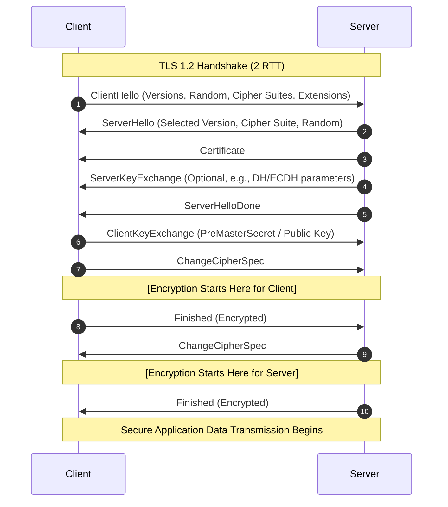
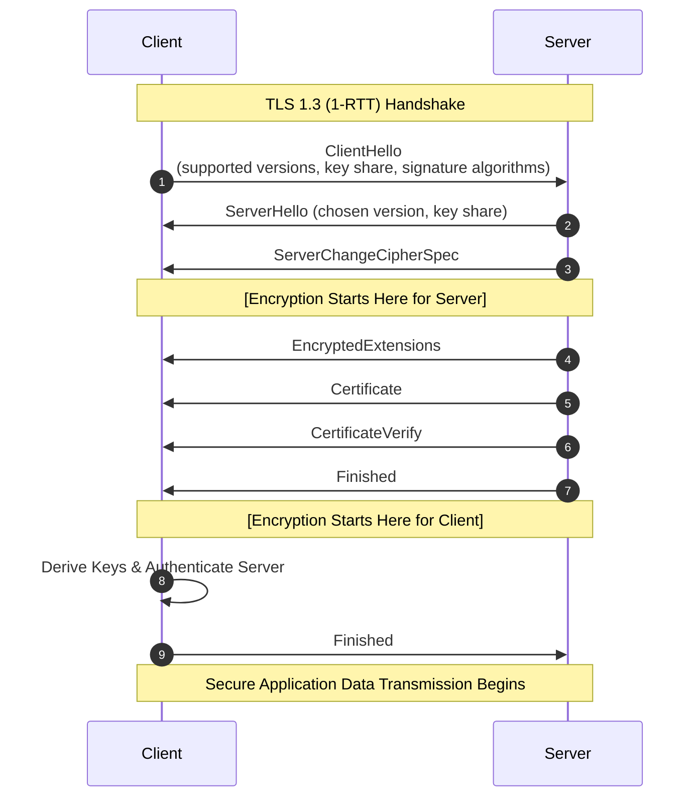
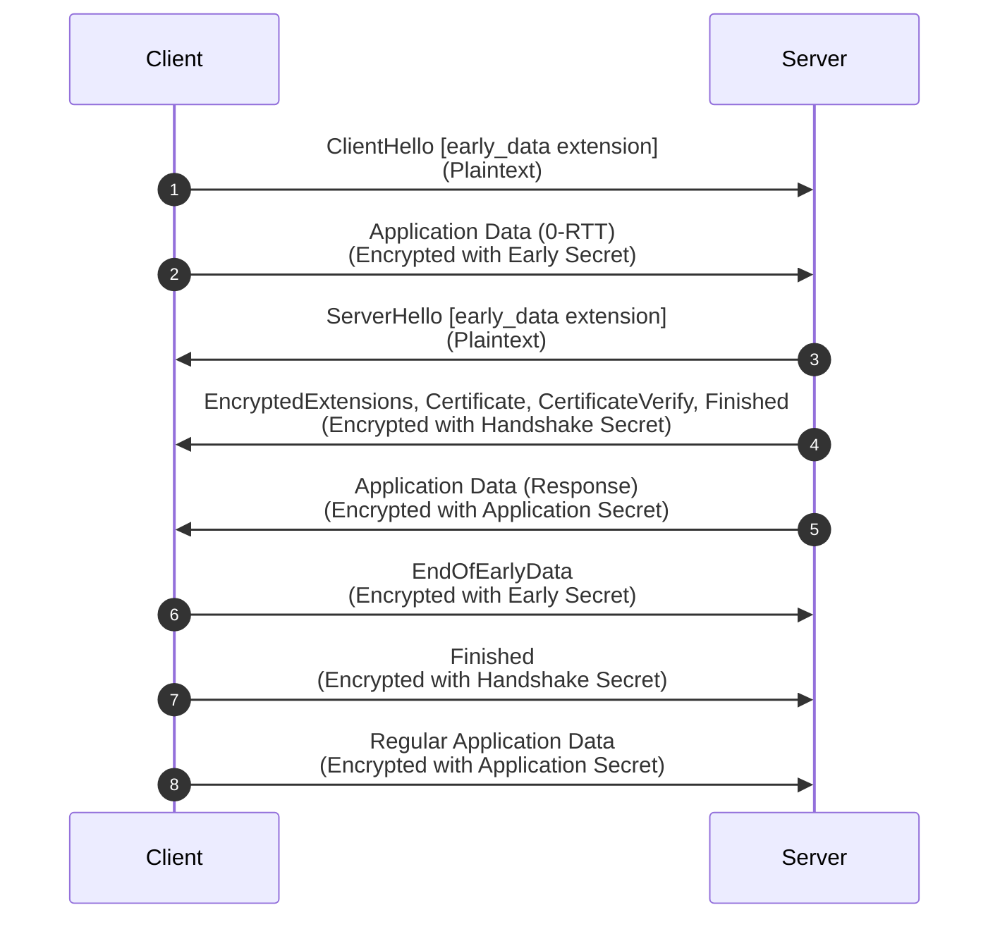

import MmtlsDump from '@site/src/components/MmtlsDump'
import {demoZeroRtt} from '@site/src/components/MmtlsDump/demo'

参考：

- [The Illustrated TLS 1.3 Connection](https://tls13.xargs.org/)
- [TLS Handshake - OSDev Wiki](https://wiki.osdev.org/TLS_Handshake)

TLS 及其使用的密码学是一项伟大的发明。今天每个人在使用互联网的时候都能享受到安全、私密的连接，加密技术和军事机构、金融设施等使用的并无二致，这都归功于 TLS.

TLS 的最小传输单位是 record，头结构为：

```c
struct TLSRecord {
    uint8_t  content_type;            // 1 Byte
    uint16_t legacy_record_version;   // 2 Bytes (Big-Endian)
    uint16_t length;                  // 2 Bytes (Big-Endian)
    opaque payload[TLSRecord.length];
};
```

Type 有以下几种类型：

- 0x14 (20): ChangeCipherSpec
- 0x15 (21): Alert
- 0x16 (22): Handshake
- 0x17 (23): Application Data

<svg viewBox="0 0 540 240" width="90%" height="auto" xmlns="http://www.w3.org/2000/svg" style={{fontFamily: "-apple-system, BlinkMacSystemFont, 'Segoe UI', Roboto, Helvetica, Arial, sans-serif"}}>
  <!-- 外层背景容器 -->
  <rect x="5" y="5" width="530" height="230" rx="12" style={{fill: 'var(--ifm-background-surface-color)', stroke: 'var(--ifm-color-emphasis-300)'}} strokeWidth="3" />
  <!-- 上层：Handshake -->
  <rect x="25" y="30" width="145" height="65" rx="8" style={{fill: 'var(--ifm-color-emphasis-100)', stroke: 'var(--ifm-color-primary)'}} strokeWidth="2.5" />
  <text x="97" y="69" fontSize="18" textAnchor="middle" fontWeight="600" style={{fill: 'var(--ifm-font-color-base)'}}>Handshake</text>
  <!-- 上层：Alert -->
  <rect x="195" y="30" width="145" height="65" rx="8" style={{fill: 'var(--ifm-color-emphasis-100)', stroke: 'var(--ifm-color-primary)'}} strokeWidth="2.5" />
  <text x="267" y="69" fontSize="18" textAnchor="middle" fontWeight="600" style={{fill: 'var(--ifm-font-color-base)'}}>Alert</text>
  <!-- 上层：Application Protocol -->
  <rect x="365" y="30" width="145" height="65" rx="8" style={{fill: 'var(--ifm-color-emphasis-100)', stroke: 'var(--ifm-color-primary-light)'}} strokeWidth="2.5" />
  <text x="437" y="58" fontSize="16" textAnchor="middle" fontWeight="600" style={{fill: 'var(--ifm-font-color-base)'}}>Application</text>
  <text x="437" y="79" fontSize="16" textAnchor="middle" fontWeight="600" style={{fill: 'var(--ifm-font-color-base)'}}>Protocol</text>
  <!-- 下层：Record -->
  <rect x="25" y="125" width="485" height="85" rx="8" style={{fill: 'var(--ifm-color-emphasis-200)', stroke: 'var(--ifm-color-primary-dark)'}} strokeWidth="3" />
  <text x="267" y="175" fontSize="22" textAnchor="middle" fontWeight="600" style={{fill: 'var(--ifm-font-color-base)'}}>Record</text>
</svg>

如图，Handshake 是 Record 的子协议。我们主要看 Handshake. Handshake 的内部结构：

```c
struct HandshakePayload {
    uint8_t msg_type;              /* 1 byte */
    uint24 length;                 /* 3 bytes */
    opaque body[Handshake.length];
};
```

Handshake 的 type 可以参考下图，包括 ClientHello、ServerHello、Certificate 等等。

在大多数情况下，握手过程中双方交换下列信息：

- 对要使用什么 cipher suites (ciphers and hash functions) 达成共识。
- server 对 client 提供自己的证书（里面包含 server 的公钥），供 client 验证自己的身份。
- 本次 TLS 会话的 session keys. 这是后续传输 Application Data 时真正使用的对称加密密钥。

交换后面这两条信息还需要用到非对称加密。

## 一些前置知识

### RSA 非对称密码

参考：https://brilliant.org/wiki/rsa-encryption/

RSA 的基本原理是：把两个超大的素数乘起来很容易，但是把乘起来的这个数分解回两个素数很难。这个两个超大素数 $p,q$ 的乘积 $n$ 就是公钥的一部分。

1. 选定两个大素数 $p,q$, 计算乘积 $n=pq$
2. 计算 $\phi(pq)=(p-1)(q-1)$ 其中 $\phi$ 是 [Euler's totient function](https://en.wikipedia.org/wiki/Euler%27s_totient_function). 然后选定一个和 $\phi(pq)$ 互质的数 $e$. 公钥即为 $\{e, n\}$
3. 计算 $e$ 在模 $\phi(n)$ 下的 modular inverse，作为私钥 $d$. 也就是 $de \equiv 1 \pmod{\phi(n)}$. 如果上一步选择的 $e$ 不与 $\phi(n)$ 互质，那它就没有模 $\phi(n)$ 下的 inverse, 因此必须互质。
4. 分发公钥 $\{e,n\}$, 私钥 $d$ 保密，只留给自己

密钥制作完成，要加解密就是把信息 $m$ 做快速幂。

加密：
$$
c \equiv m ^ e \pmod n
$$
得到 ciphertext $c$

解密：
$$
c ^ d \equiv m \pmod n
$$
如果 $m$ 比 $n$ 还大，那就只能得到 $m \bmod n$ 了。由此可见 RSA 只适合加密不太长的密文，而且公钥比较长。这就是为什么 TLS 需要用非对称加密协商出对称加密的密钥(master secret)然后只使用对称加密。

正确性证明见附录 A, 其实很短（

RSA 的问题在于公钥很长，所以后面又发展了基于椭圆曲线的非对称加密算法如 Ed25519，但是对外抽象出的接口和 RSA 一样，也是公钥私钥。

### Diffie–Hellman 密钥交换

原版 DH 很简单：

1. 双方确定一个大素数 $p$ (名字源于prime) 和一个随机数 $g$ (名字源于generator)，可以明文公开，固定不变
2. 客户端随机选一个数 $a$ （私钥）不告诉任何人，只明文发给服务器 $A=g^a \bmod p$（公钥）
3. 服务器随机选一个数 $b$ （私钥）不告诉任何人，只明文发给客户端 $B=g^b \bmod p$（公钥）
4. 两边同时把收到的数和自己随机选的数做快速幂，都能得到 $g^{ab} \bmod p$, 这就是交换出的共有密钥。

DH (Diffie-Hellman) 和 DHE (Diffie-Hellman Ephemeral) 的区别就是每次连接用不同的 $a$ 和 $b$（Ephemeral）, $g$ 和 $p$ 一般是固定的。

DH 的私钥是**绝对不会在网络上传输的**。

DH 也有椭圆曲线的版本，为 ECDH 和 ECDHE, 大部分网站使用 ECDHE.

密钥交换表面上看起来已经足够了，但是实际上攻击者可能会充当中间人，为了验证服务器的身份，还是需要 RSA 或者 Ed25519.

### 椭圆曲线

参考：[A (Relatively Easy To Understand) Primer on Elliptic Curve Cryptography](https://blog.cloudflare.com/a-relatively-easy-to-understand-primer-on-elliptic-curve-cryptography/)

ECDH 密钥交换：

1. 双方确定一个 y² = x³ + ax + b Weierstrass 椭圆曲线的 `a`，`b` 和 `max` (坐标系在哪里 warp around), 还有生成点 $G$ (二维坐标).
2. 客户端随机选一个标量 $b$ 不告诉任何人，只明文发给服务器 $P_a = G \cdot a$
3. 服务器随机选一个标量 $a$ 不告诉任何人，只明文发给客户端 $P_b = G \cdot b$
4. 跟 DH 思路一样，把收到的点和自己的随机标量乘起来，两边都能得到 $K=G \cdot a \cdot b$

注意这里的标量和椭圆曲线上的点做乘积是一个专门定义的操作，不是向量和标量的乘积。

同样这里的标量私钥也绝不会在网络上传输。

上述为经典标准 ECDH 密钥交换，现代密码学工业标准如 X25519 明确指定了 1 中使用的曲线（没有用 Weierstrass 椭圆曲线而是改用了一个指定的 Montgomery 曲线），以及做了一些防呆设计。

## TLS 1.2



1. 客户端发送 ClientHello，告诉服务器：这是我的 ClientRandom 随机数，这是我支持的加密套件，这是我的扩展
2. 服务器发送 ServerHello：这是我选中的加密套件，这是我的 ServerRandom 随机数
3. 服务器提供自己的证书，包含证书公钥。若使用 RSA 密钥交换，客户端会用这个 RSA 公钥加密 Pre-master Secret.
4. 若使用 DH 密钥交换，服务器发送密钥交换参数，包含本次握手生成的 DH 公钥。为了防止中间人篡改或伪造这些参数，服务器会用自己证书中的私钥，对一段特定数据（包含：Client Hello 随机数 + Server Hello 随机数 + 服务器的 DH 参数）进行数字签名，附在后面一起发送。
5. 服务器：我已经发完本次连接的握手信息了。
6. 客户端向服务器交换密钥。若使用 RSA 密钥交换，客户端会直接本地生成 Pre-master Secret 然后用证书 RSA 公钥加密后发给服务器。若使用 DH 密钥交换，客户端会把本次握手的 DH 公钥发给服务器，并把客户端 DH 私钥和 4 中收到的服务器 DH 公钥相乘得到 Pre-master Secret. 然后使用下面的算法生成 Master Secret. 服务器也可以用同样的算法生成同样的 Master Secret.

```
seed = "master secret" + client_random + server_random
a0 = seed
a1 = HMAC-SHA256(key=PreMasterSecret, data=a0)
a2 = HMAC-SHA256(key=PreMasterSecret, data=a1)
p1 = HMAC-SHA256(key=PreMasterSecret, data=a1 + seed)
p2 = HMAC-SHA256(key=PreMasterSecret, data=a2 + seed)
MasterSecret = p1[all 32 bytes] + p2[first 16 bytes]
```

得到 Master Secret 后可以派生出后续使用的 session keys

```
seed = "key expansion" + server_random + client_random
a0 = seed
a1 = HMAC-SHA256(key=MasterSecret, data=a0)
a2 = HMAC-SHA256(key=MasterSecret, data=a1)
a3 = HMAC-SHA256(key=MasterSecret, data=a2)
a4 = ...
p1 = HMAC-SHA256(key=MasterSecret, data=a1 + seed)
p2 = HMAC-SHA256(key=MasterSecret, data=a2 + seed)
p3 = HMAC-SHA256(key=MasterSecret, data=a3 + seed)
p4 = ...
p = p1 + p2 + p3 + p4 ...
client write mac key = [first 20 bytes of p]
server write mac key = [next 20 bytes of p]
client write key = [next 16 bytes of p]
server write key = [next 16 bytes of p]
client write IV = [next 16 bytes of p]
server write IV = [next 16 bytes of p]
```

7. 客户端：我切换到加密连接了，后续 record 都是 session keys 加密的。
8. 客户端：我已经发完本次连接的握手信息了。为了防止中间人攻击，发送 verify data: `hash(所有握手信息)` 。注意这个 record 经过密钥加密。
9. 服务器得到 Pre-master Secret, 用同样的方式派生出同样的密钥，然后告诉客户端：我已经切换到加密连接了，后续 record 都是加密的。
10. 服务器：完成 Handshake 了，我也发送 verify data: `hash(所有握手信息)` 供客户端验证。同样这个 record 经过加密。
11. 双方开始正式传输 Application Data

## TLS 1.3 (1-RTT)

上面 TLS 1.2 的握手过程是 2-RTT 的，仔细观察会发现第一个 RTT 是在协商用什么加密套件，因为必须得确定好用什么加密套件，才能交换密钥。如果客户端提前猜一个服务器支持的加密套件，然后在 ClientHello 的时候就顺便发送 ClientKeyExchange, 服务器看到了就直接回 ServerHello 和 ServerKeyExchange 那么就可以省下一个 RTT. 这就是 TLS 1.3 1-RTT 完整握手模式.

此外 TLS 1.3 抛弃了 RSA 密钥交换方式，只剩 (EC)DHE 密钥交换方式。



1. 客户端发送 ClientHello, 为了兼容性所以保留了 TLS 1.2 的格式，使用**扩展**发送 TLS 1.3 新加的字段：支持的 TLS 版本、密钥交换信息、客户端支持的签名算法
2. 服务器发送 ServerHello, 扩展包含服务器支持的版本（自然就是 TLS 1.3 了）、密钥交换信息
3. 服务器派生出 session keys, 告诉客户端：我接下来要加密传输信息了
4. 为了兼容性所以会假装为成功 resume 的 TLS 1.2 session, 实际上传输 EncryptedExtensions，包含不需要明文暴露的**扩展**
5. 服务器证书
6. 服务器用证书私钥给密钥交换时的信息签名，以证明自己的身份
7. 服务器告诉客户端握手阶段结束。和 TLS 1.2 一样，会附上 verify data
8. 客户端派生密钥并验证服务器身份
9. 客户端告诉服务器握手阶段结束。和 TLS 1.2 一样，会附上 verify data

## TLS 1.3 (0-RTT)

如果双方已经提前交换好了一个 PSK (pre-shared key), 那么可以做到 0-RTT: 在 ClientHello 里带上 PSK 和 `early_data` 扩展，后面紧跟着就把 Application Data 发出去。



如何交换 PSK 呢？一种方法是在一次完整 1-RTT 握手结束后，服务器会给客户端发一个 NewSessionTicket，里面包含 ticket 和 `max_early_data_size`. 客户端下次连接就把 ticket 放进 ClientHello 的 `pre_shared_key` 扩展。这个扩展还带一个 binder, 它是对（去掉 binders 的）ClientHello 做的 HMAC, key 由 PSK 派生，所以既能证明自己确实持有 PSK, 又能防止中间人篡改 ClientHello 里的其它字段。也因此 `pre_shared_key` 必须是 ClientHello 的最后一个扩展，否则没法对着“完整的” ClientHello 算 HMAC.

0-RTT 的密钥只由 PSK 得到：

```
/* 1. 提取 Early Secret */
// 若无预共享密钥 (PSK)，则 PSK 输入为全 0 的 Hash_Len 字节串
Early_Secret = HKDF-Extract(salt = 0, IKM = PSK)

/* 2. 派生 client_early_traffic_secret */
// 基于 Early Secret 与 ClientHello 上下文派生
client_early_traffic_secret = HKDF-Expand-Label(
    secret  = Early_Secret,
    label   = "c e traffic",
    context = Transcript-Hash(ClientHello),
    length  = Hash_Len
)
```

服务器看到 `early_data` 有三种选择：

1. 忽略它、回退到 1-RTT
2. 回一个 HelloRetryRequest (之后客户端不能再发 0-RTT)
3. 接受。接受的条件是 PSK 是客户端列出的第一个 identity, 并且版本、加密套件、ALPN 都和当初发 ticket 的那次连接一致。接受的话，服务器在 EncryptedExtensions 里回一个 `early_data` 表示“我收了”。客户端收到服务器的 Finished 后，先发一个 `EndOfEarlyData` 表示 0-RTT 数据已经发完，从这里开始换回握手密钥，然后再发自己的 Finished.

0-RTT 的缺点：

- **没有前向保密。** early data 的密钥只由 PSK 派生，不含本次握手的 (EC)DHE. PSK 一旦泄露，之前的 0-RTT 数据就都能被解开。
- **可以重放。** 1-RTT 及之后的数据依赖 ServerHello 里的 random, 每次连接都不同；0-RTT 数据不依赖它，攻击者把 ClientHello + early data 原样再发一遍，服务器算出来的 key 是一样的。所以 RFC 要求客户端只把**可以安全重放**的数据放进 0-RTT (一般就是幂等的请求), 服务端则用一次性 ticket 或者记录最近收到的 ClientHello 来防重放。很多实现也就只把 GET 之类放进来。

## 附录

### A. RSA 正确性证明

RSA 使用的数学原理是 [Euler's theorem](https://en.wikipedia.org/wiki/Euler%27s_theorem), 它告诉我们
$$
m^{\phi(n)} \equiv 1 \pmod n
$$
加上上面第三步
$$
de \equiv 1 \pmod{\phi(n)}
$$
所以
$$
m^{de} \equiv m^{k\phi(n)+1} \equiv m^{k\phi(n)} \cdot m \equiv (m^{\phi(n)})^k \cdot m \equiv 1^k \cdot m \equiv m \pmod n
$$
