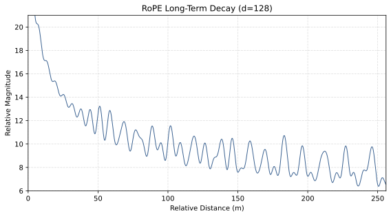
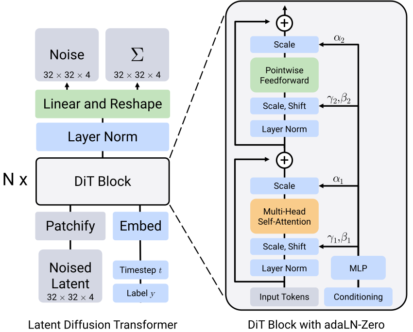

RoPE 是一种用于 Transformer 模型的位置编码, 它的发明者 苏剑林 已经在博客里做了很好的介绍：[Transformer升级之路：2、博采众长的旋转式位置编码](https://www.spaces.ac.cn/archives/8265)。

为了演示位置编码，假设有一个二维列向量 $\boldsymbol{q}$ 位于位置 $m$，还有一个二维列向量 $\boldsymbol{k}$ 位于位置 $n$. RoPE 根据各自的绝对位置旋转它们，并使点积依赖相对位置：

$$
\tilde{\boldsymbol{q}}_m = \boldsymbol{f}(\boldsymbol{q}, m), \quad\tilde{\boldsymbol{k}}_n = \boldsymbol{f}(\boldsymbol{k}, n)
$$

我们把一个二维向量看成一个复数，二维向量的第一维表示实部，第二维表示虚部。任何非零复数 $z$ 都可以写成指数形式 $z = R e^{\mathrm{i}\Theta}$，其中 $R > 0$ 为模长，$\Theta$ 为辐角。

RoPE 的具体公式为：

$$
\boldsymbol{f}(\boldsymbol{q}, m) = R_f (\boldsymbol{q}, m)e^{\text{i}\Theta_f(\boldsymbol{q}, m)} 
= \Vert q\Vert e^{\text{i}(\Theta(\boldsymbol{q}) + m\theta)} = \boldsymbol{q} e^{\text{i}m\theta}
$$

<!-- truncate -->

回到二维向量的视角，那么 RoPE 的矩阵形式为：

$$
\boldsymbol{f}(\boldsymbol{q}, m) ={\mathcal{R}}_m \boldsymbol{q} = \begin{pmatrix}\cos m\theta & -\sin m\theta\\ \sin m\theta & \cos m\theta\end{pmatrix} \begin{pmatrix}q_0 \\ q_1\end{pmatrix}
$$

很妙的是，在 attention 中将会对 $\boldsymbol{q}$ 和 $\boldsymbol{k}$ 进行点积，点积的结果自然带上了 $\boldsymbol{q}$ 和 $\boldsymbol{k}$ 的**相对**位置信息

$$
(\boldsymbol{\mathcal{R}}_m \boldsymbol{q})^{\top}(\boldsymbol{\mathcal{R}}_n \boldsymbol{k}) =  \boldsymbol{q}^{\top} \boldsymbol{\mathcal{R}}_m^{\top}\boldsymbol{\mathcal{R}}_n \boldsymbol{k} = \boldsymbol{q}^{\top} \boldsymbol{\mathcal{R}}_{n-m} \boldsymbol{k}
$$

回顾一下单个 attention head 的注意力机制：$Q$ 的 shape 为 $N \times d_k$，$K$ 为 $M \times d_k$，$V$ 为 $M \times d_v$，这里省略 batch 维度。Klein 中，每个 head 的 $d_k=d_v=d_h$；模型隐藏维度则是 head 数乘以 $d_h$。那么注意力机制的输出为：

$$
\text{Attention}(Q, K, V) = \text{softmax}\left
(\frac{QK^{\top}}{\sqrt{d_k}}\right)V
$$

本文把缩放后的 $QK^{\top}/\sqrt{d_k}$ 称为注意力分数矩阵（logits），shape 为 $N \times M$。softmax 沿 key 维度计算，得到注意力概率矩阵，每一行的元素和为 1。上式假设没有额外的 attention mask。

对于二维图像，一种做法是采用分轴 RoPE：把部分通道分配给 $x$ 坐标，其余通道分配给 $y$ 坐标。下面用两个二维旋转块示意；实际模型每个轴通常有多个频率，不同轴也不必均分通道。

$$
\boldsymbol{\mathcal{R}}_{x,y}=\left(
\begin{array}{cccc} 
\cos x\theta & -\sin x\theta & 0 & 0 \\ 
\sin x\theta & \cos x\theta & 0 & 0 \\ 
\hline
0 & 0 & \cos y\theta & -\sin y\theta \\ 
0 & 0 & \sin y\theta & \cos y\theta \\ 
\end{array}\right)
$$

FLUX .2 Klein 使用四轴 $(t,h,w,l)$，分别对应

- time: 时间/图像索引。区分多个参考图和目标生成图像
- height: 图像 token 的垂直位置
- width: 图像 token 的水平位置
- length: 文本 token 的位置，图像 token 的 length 恒为 0.

## 远程衰减

位置编码，无论是原版 Transformer 的正弦余弦位置编码，还是 RoPE，都有一个特性：空间上越接近的 token 越容易互相注意。两个 token 隔得越远，通常它们的注意力分数越小。非常合理。

如何证明这一特性呢？同样参考 苏剑林 的博客。

这里回到一个轴的 RoPE, 在 Transformer 中，$\boldsymbol{q}$ 和 $\boldsymbol{k}$ 是 $d$ 维的列向量。

$$
(\boldsymbol{\mathcal{R}}_m \boldsymbol{q})^{\top}(\boldsymbol{\mathcal{R}}_n \boldsymbol{k}) = \text{Re}\left[\sum_{i=0}^{d/2-1}\boldsymbol{q}_{[2i:2i+1]}\boldsymbol{k}_{[2i:2i+1]}^* e^{\text{i}(m-n)\theta_i}\right]
$$

记 $h_i = \boldsymbol{q}_{[2i:2i+1]}\boldsymbol{k}_{[2i:2i+1]}^*, S_j = \sum\limits_{i=0}^{j-1} e^{\text{i}(m-n)\theta_i}$，并约定 $h_{d/2}=0,S_0=0$，那么由Abel变换（分部求和法）可以得到：

$$
\sum_{i=0}^{d/2-1}\boldsymbol{q}_{[2i:2i+1]}\boldsymbol{k}_{[2i:2i+1]}^* e^{\text{i}(m-n)\theta_i} = \sum_{i=0}^{d/2-1} h_i (S_{i 
+1} - S_i)  = -\sum_{i=0}^{d/2-1} S_{i+1}(h_{i+1} - h_i)
$$

所以

$$
\begin{aligned} 
\left|\sum_{i=0}^{d/2-1}\boldsymbol{q}_{[2i:2i+1]}\boldsymbol{k}_{[2i:2i+1]}^* e^{\text{i}(m-n)\theta_i}\right| =&\, \left|\sum_{i=0}^{d/2-1} S_{i+1}(h_{i+1} - h_i)\right| \\ 
\leq&\, \sum_{i=0}^{d/2-1} |S_{i+1}| |h_{i+1} - h_i| \\ 
\leq&\, \left(\max_i |h_{i+1} - h_i|\right)\sum_{i=0}^{d/2-1} |S_{i+1}| 
\end{aligned}
$$

这给我们一个注意力分数的**上界**，为了排除通道数量 $d$ 的影响，我们可以算 $|S_i|$ 的平均值，也就是除以 $d/2$ 得到 $\frac{1}{d/2}\sum\limits_{i=1}^{d/2} |S_i|$.

```python
import matplotlib.pyplot as plt
import numpy as np

# 1. 参数设置 (对应 d = 128)
d = 128
half_d = d // 2

# 2. 计算频率 theta_i = 10000^(-2i/d), i = 0, 1, ..., d/2 - 1
i = np.arange(half_d)
theta = 10000.0 ** (-2 * i / d)


# 3. 定义衰减函数 f(m), 其中 m 代表相对距离
def f(m):
  # 计算各个频率下的复数旋转项: e^(i * m * theta)
  # 形状: (len(m), d/2)
  exp_terms = np.exp(1j * np.outer(m, theta))

  # 沿频率维度做前缀和，得到 S_1, S_2, ..., S_{d/2}
  S = np.cumsum(exp_terms, axis=1)

  # 对每个 S_j 取模长 (Norm) 后求平均 (除以 d/2)
  return np.mean(np.abs(S), axis=1)


# 4. 生成相对距离 m ∈ [0, 256] 并绘图
# 取密集采样点以还原连续振荡曲线的细节
m_vals = np.linspace(0, 256, 2000)
y_vals = f(m_vals)

plt.figure(figsize=(8, 4.5), dpi=150)
plt.plot(m_vals, y_vals, linewidth=1.0, color="#3b6291")

plt.xlabel("Relative Distance (m)")
plt.ylabel("Relative Magnitude")
plt.title(f"RoPE Long-Term Decay (d={d})")
plt.xlim(0, 256)
plt.ylim(6, 21)  # 截断顶部峰值
plt.grid(True, linestyle="--", alpha=0.4)
plt.tight_layout()
fig.savefig("rope_decay.svg", format="svg", bbox_inches="tight")
```



可见注意力分数的**上界**是会随着相对距离而衰减的。那么 DiT 中的注意力分数具体会不会这样衰减呢？

## DiT 中的 RoPE

下面借用原始 DiT 论文 [Scalable Diffusion Models with Transformers](https://arxiv.org/abs/2212.09748) 的架构图说明 RoPE 起作用的位置，研究 RoPE 和模型其余部分的交互。

（原始 DiT 论文使用 Transformer 论文里的正弦余弦位置编码，本文不讨论这种位置编码，只集中精力在新的，且得到普遍应用的 RoPE 上。）



在第一轮去噪时，输入 latent 是随机噪声。这里有一个问题：RoPE 怎样在高斯噪声输入上提供“远程衰减”特性？也即空间上越接近的 token 越容易互相注意。

假如 $\boldsymbol{q}$ 和 $\boldsymbol{k}$ 是高斯噪声，它们的方向是随机的，RoPE 将 $\boldsymbol{q}$ 和 $\boldsymbol{k}$ 旋转一定的角度，旋转后的 $\boldsymbol{q}$ 和 $\boldsymbol{k}$ 的方向仍然是随机的。也就是说，RoPE 没有真正起作用！不过实际情况并不是这样。在输入的噪声 latent 和 $\boldsymbol{q}$ 和 $\boldsymbol{k}$ 之间还有输入投影、LayerNorm、adaLN、Q/K 投影以及 QK Norm. 哪一层发挥了作用呢？

我做了一个简单的实验，从实验结果来看，**adaLN 的共享 shift 是 Klein 第一层稳定行列偏好的主要来源之一。** 它为不同图像 token 提供公共分量，该分量经过投影和 RoPE 后，可以形成随相对位置变化的打分。

> 以**开启 RoPE 相比关闭 RoPE，同一行或列所获注意力的增量**为指标，排除自身位置并重新归一化：
>
> - 完整路径: 约 +12.26 个百分点。
> - 去掉 shift: 约 +1.75 个百分点。
> - 去掉 AdaLN 的 shift 和 scale: 约 +0.93 个百分点。
> - 只保留 shift: 约 +13.70 个百分点。
> 
> 这支持共享 shift 在这个指标上起主要作用。Q/K 的学习投影和 QK Norm 权重也会改变结果。这里的行列偏好是该权重和实验设置下的观察，并非任意 RoPE 都必然产生的性质。

adaLN 层具体做了什么呢？如上图右侧所示，全局 condition（例如原始 DiT 中的 timestep 和 class label）经过 embedding 和 MLP，生成 scale、shift 和 gate。本文以 $D$ 表示模型隐藏维度，$\boldsymbol{\gamma},\boldsymbol{\beta},\boldsymbol{\alpha}\in\mathbb{R}^{D}$；其中 $\gamma$ 表示 scale，$\beta$ 表示 shift，$\alpha$ 表示残差分支的 gate。

[LayerNorm(D)](https://docs.pytorch.org/docs/2.15/generated/torch.nn.LayerNorm.html) 在 `[B, H*W, D]` 输入下，对**每个样本的每个 token 的 D 个通道**分别计算均值和方差，不会把所有空间位置一起归一化。以下 $x_i$ 表示一个 token，省略 batch 下标，并写出不带固定可学习仿射参数的基础 LayerNorm：

$$
\hat{\boldsymbol{x}}_i = \frac{\boldsymbol{x}_i - \mu_i}{\sqrt{\sigma_i^2+\epsilon}}
$$

adaLN 在 LayerNorm 的基础上, 对归一化后的结果进行缩放和偏移：

$$
\boldsymbol{u}_i=\text{adaLN}(\boldsymbol{x}_i) = \boldsymbol{\gamma} \odot \hat{\boldsymbol{x}}_i + \boldsymbol{\beta}
$$

Klein 实现里写作 $(1+\text{scale})\odot\hat{x}+\text{shift}$，所以这里的 $\gamma=1+\text{scale}$，$\beta=\text{shift}$。同一次前向中，图像 token 共享这两个向量；它们会随 timestep 改变。gate 则乘在子层输出上，参与残差更新，不直接加到 Q/K 上。

先忽略 QK Norm。统一使用列向量，对单个 head 的无 bias 投影写成：

$$
\begin{aligned}
\boldsymbol{q}_i&=W_q(\boldsymbol{\gamma}\odot\hat{\boldsymbol{x}}_i+\boldsymbol{\beta})=W_q(\boldsymbol{\gamma}\odot\hat{\boldsymbol{x}}_i)+W_q\boldsymbol{\beta} \\
\boldsymbol{k}_j&=W_k(\boldsymbol{\gamma}\odot\hat{\boldsymbol{x}}_j+\boldsymbol{\beta})=W_k(\boldsymbol{\gamma}\odot\hat{\boldsymbol{x}}_j)+W_k\boldsymbol{\beta}
\end{aligned}
$$

其中 $W_q,W_k\in\mathbb{R}^{d_h\times D}$。下文以 $\mathcal{R}_{j-i}$ 简记由坐标差决定的旋转；二维时应理解为 $\mathcal{R}_{x_j-x_i,y_j-y_i}$，而非展平 token 序号之差。注意力分数为：

$$
\begin{aligned}
L_{ij}
&=\frac{(\mathcal{R}_i\boldsymbol{q}_i)^\top(\mathcal{R}_j\boldsymbol{k}_j)}{\sqrt{d_h}}\\
&=\frac{\bigl(W_q(\boldsymbol{\gamma}\odot\hat{\boldsymbol{x}}_i)+W_q\boldsymbol{\beta}\bigr)^\top
\mathcal{R}_{j-i}\bigl(W_k(\boldsymbol{\gamma}\odot\hat{\boldsymbol{x}}_j)+W_k\boldsymbol{\beta}\bigr)}{\sqrt{d_h}}
\end{aligned}
$$

交叉相乘展开：

$$
\begin{aligned}
\sqrt{d_h}L_{ij}
={}&\underbrace{\bigl(W_q(\boldsymbol{\gamma}\odot\hat{\boldsymbol{x}}_i)\bigr)^\top\mathcal{R}_{j-i}\bigl(W_k(\boldsymbol{\gamma}\odot\hat{\boldsymbol{x}}_j)\bigr)}_{\text{content-content}}\\
&+\underbrace{\bigl(W_q(\boldsymbol{\gamma}\odot\hat{\boldsymbol{x}}_i)\bigr)^\top\mathcal{R}_{j-i}(W_k\boldsymbol{\beta})}_{\text{content-shift}}\\
&+\underbrace{(W_q\boldsymbol{\beta})^\top\mathcal{R}_{j-i}\bigl(W_k(\boldsymbol{\gamma}\odot\hat{\boldsymbol{x}}_j)\bigr)}_{\text{shift-content}}\\
&+\underbrace{(W_q\boldsymbol{\beta})^\top\mathcal{R}_{j-i}(W_k\boldsymbol{\beta})}_{\text{shift-shift}}
\end{aligned}
$$

有 4 项：

1. content-content：两个 token 内容分量之间的匹配，也受到 RoPE 影响。
2. content-shift：query 的内容分量与 key 的共享 shift 分量之间的匹配。
3. shift-content：query 的共享 shift 分量与 key 的内容分量之间的匹配。
4. shift-shift（SS）：在这个忽略 QK Norm 的模型中，同一前向、同一 head 内仅由相对位置和共享 shift 决定，可视为条件相关的相对位置偏置。

## 加上真实的 QK Norm

Klein 在 Q/K 投影之后、RoPE 之前，还会做带可学习 gain 的 RMSNorm。以 Q 为例：

$$
\begin{aligned}
\boldsymbol{z}_{q,i}&=W_q(\boldsymbol{\gamma}\odot\hat{\boldsymbol{x}}_i+\boldsymbol{\beta})\\
r_{q,i}&=\sqrt{\frac{1}{d_h}\|\boldsymbol{z}_{q,i}\|^2+\epsilon_q}\\
\boldsymbol{q}_i&=\frac{\boldsymbol{g}_q\odot\boldsymbol{z}_{q,i}}{r_{q,i}}
=\underbrace{\frac{\boldsymbol{g}_q\odot\bigl(W_q(\boldsymbol{\gamma}\odot\hat{\boldsymbol{x}}_i)\bigr)}{r_{q,i}}}_{\boldsymbol{C}_{q,i}}
+\underbrace{\frac{\boldsymbol{g}_q\odot W_q\boldsymbol{\beta}}{r_{q,i}}}_{\boldsymbol{S}_{q,i}}
\end{aligned}
$$

K 同理。这里两个分量必须使用**完整有 shift 输入的同一个分母**；RMSNorm 不是线性的，不能分别归一化 content 和 shift 再相加。四项展开仍然成立，只需分别用 $C_q,S_q,C_k,S_k$ 代替上述分量。

此时 SS 项为：

$$
P_{SS}(i,j)=\frac{\boldsymbol{S}_{q,i}^{\top}\mathcal{R}_{j-i}\boldsymbol{S}_{k,j}}{\sqrt{d_h}}
$$

虽然 shift 的投影在 token 间共享，但分母 $r_{q,i},r_{k,j}$ 随 token 内容变化。因此，真实 SS 项是**由内容相关幅度调制的相对位置核**，不是严格独立于内容的固定位置偏置。用完整分母分解出的 $C_{q,i}$ 也不等于实际删除 shift 后重新计算的 Q。

若要只研究 SS 中的 RoPE 位置效应，可以定义：

$$
\Delta P_{SS}(i,j)=
\frac{\boldsymbol{S}_{q,i}^{\top}(\mathcal{R}_{j-i}-I)\boldsymbol{S}_{k,j}}{\sqrt{d_h}}
$$

它与完整旋转后的 $P_{SS}$ 不同。被减去的未旋转项也会因 key 的 RMSNorm 分母变化而变化，不能一概当作会被 softmax 抵消的行常数。

(有待进一步研究，待续)